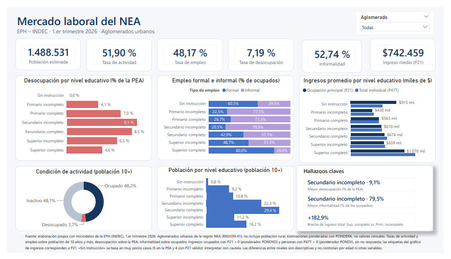

# Mercado_Laboral_NEA_EPH_2026T1
Análisis de empleo, educación e ingresos en los aglomerados urbanos del NEA argentino con microdatos de la EPH (INDEC, 1.er trim. 2026). Limpieza y validación en Python y dashboard en Power BI con indicadores ponderados.
# Empleo, educación e ingresos en el NEA argentino (EPH, 1.er trimestre 2026)

Este proyecto analiza la relación entre el nivel educativo y la situación laboral en los aglomerados urbanos de la región Noreste Argentino (NEA) a partir de los microdatos de la Encuesta Permanente de Hogares (EPH) del INDEC, primer trimestre de 2026.

La limpieza y el análisis exploratorio se realizaron en Python (Google Colab y pandas), y los resultados se presentan en un dashboard de una sola página en Power BI. Todos los indicadores del dashboard fueron validados contra cálculos independientes en Python.

---

## Objetivo del proyecto

- Analizar la **desocupación** según nivel educativo.
- Analizar la **informalidad laboral** según nivel educativo.
- Explorar la relación entre **nivel educativo e ingresos** (ocupación principal e ingreso total individual).
- Construir un dashboard profesional, metodológicamente correcto, que diferencie frecuencias muestrales de estimaciones poblacionales.

---

## Dataset utilizado

- **Fuente:** microdatos de la EPH, base individual, INDEC (`usu_individual_T126.txt`).
- **Período:** primer trimestre de 2026.
- **Formato original:** archivo de texto delimitado por `;` con coma decimal (todo el país).
- **Cobertura:** región NEA (`REGION = 41`), compuesta por los aglomerados urbanos de Posadas, Gran Resistencia, Corrientes y Formosa. **No incluye población rural.**
- **Registros:** 43.739 en el archivo original; **4.589** en el NEA.
- **Variables:** 234 en el archivo original; se utilizaron 14 en Power BI.

### Variables principales

| Variable | Descripción |
|---|---|
| `NIVEL_ED` | Nivel educativo |
| `ESTADO` | Condición de actividad (1 ocupado, 2 desocupado, 3 inactivo, 4 menor de 10 años, 0 sin información) |
| `EMPLEO` | Empleo formal (1) o informal (2); vacío para no ocupados |
| `P21` | Ingreso de la ocupación principal |
| `P47T` | Ingreso total individual |
| `T_VI` | Ingresos no laborales |
| `PONDERA` | Factor de expansión individual |
| `PONDIIO` | Ponderador para ingresos de la ocupación principal (P21) |
| `PONDII` | Ponderador para ingresos individuales (P47T) |
| `REGION`, `AGLOMERADO` | Ubicación geográfica |
| `CODUSU`, `NRO_HOGAR`, `COMPONENTE` | Identificadores del registro (sin duplicados en el NEA) |

---

## Metodología

**Resultados poblacionales.** Los indicadores son estimaciones ponderadas de la población representada por la EPH en los aglomerados urbanos del NEA, no valores censales ni estimaciones de toda la región.

**Ponderadores**
- Tasas y distribuciones: `PONDERA`.
- Ingreso de la ocupación principal (P21): `PONDIIO`.
- Ingreso total individual (P47T): `PONDII`.

**Definición de las tasas**

| Indicador | Numerador | Denominador |
|---|---|---|
| Tasa de actividad | Ocupados + desocupados (PEA) | Población de 10 años y más (`ESTADO` 1, 2, 3) |
| Tasa de empleo | Ocupados | Población de 10 años y más |
| Tasa de desocupación | Desocupados | PEA |
| Tasa de informalidad | Ocupados informales (`EMPLEO = 2`) | Ocupados |

**Ingresos**
- El valor `-9` (falta de respuesta) se reemplazó por vacío; no se trata como ingreso.
- P21: promedio ponderado entre ocupados con `P21 > 0`.
- P47T: promedio ponderado entre personas con `P47T > 0`.
- Los universos de P21 y P47T son distintos, por lo que sus promedios no son directamente comparables en cobertura.

**Distribución por nivel educativo.** Se calcula sobre la población de 10 años y más. Los menores de 10 años se cargan casi todos como «Primario incompleto» o «Sin instrucción», y distorsionarían esas categorías si se incluyeran.

---

## Herramientas utilizadas

- **Python** (pandas, matplotlib) en **Google Colab**: limpieza, exploración, graficos y validación.
- **Power BI Desktop**: Power Query, modelado de datos, medidas DAX y dashboard.
- **GitHub**: control de versiones y publicación.

---

## Modelo de datos (Power BI)

Modelo estrella con una tabla de hechos y cuatro dimensiones:

- `Fact_EPH`: 4.589 registros del NEA, con los ponderadores y las variables de análisis.
- `Dim_NivelEd`, `Dim_Estado`, `Dim_Empleo`, `Dim_Aglomerado`: etiquetas legibles y orden lógico de las categorías.
- `_Medidas`: tabla contenedora de las medidas DAX.

Las relaciones son de uno a varios, con filtro en una sola dirección (de la dimensión hacia la tabla de hechos).

**Medidas principales:** población estimada, población de 10 años y más, ocupados, desocupados, PEA, las cuatro tasas, distribuciones porcentuales por nivel educativo y por condición de actividad, ingresos promedio ponderados (P21 y P47T), brecha de ingresos y los textos de hallazgos dinámicos.

**Decisión técnica:** el producto «ingreso × ponderador» y el universo de cálculo (ocupado con ingreso positivo) se resolvieron con columnas auxiliares en Power Query. De este modo, las medidas de ingreso se reducen a un cociente de dos sumas.

---

## Dashboard



Dashboard de una página con:

- **Seis tarjetas KPI:** población estimada, tasas de actividad, empleo, desocupación e informalidad, e ingreso medio de la ocupación principal.
- **Desocupación por nivel educativo** (% de la PEA).
- **Empleo formal e informal por nivel educativo** (% de ocupados).
- **Ingresos promedio por nivel educativo** (P21 y P47T).
- **Condición de actividad** y **población por nivel educativo** (población de 10 años y más).
- **Hallazgos clave** dinámicos.
- **Segmentador por aglomerado** que filtra toda la página.

---

## Resultados principales

| Indicador | Valor |
|---|---|
| Población estimada (aglomerados urbanos NEA) | 1.488.531 |
| Tasa de actividad | 51,90 % |
| Tasa de empleo | 48,17 % |
| Tasa de desocupación | 7,19 % |
| Tasa de informalidad | 52,74 % |
| Ingreso medio de la ocupación principal (P21) | $742.459 |
| Ingreso total individual medio (P47T) | $789.234 |

- La desocupación más alta se observa en **Secundario incompleto** (9,1 % de la PEA) y la más baja entre quienes tienen **Superior completo** (4,6 %).
- La informalidad más alta también corresponde a **Secundario incompleto** (79,5 % de los ocupados); con **Superior completo** baja a 20,0 %.
- El ingreso total individual medio de quienes tienen **Superior completo** es un **182,9 % mayor** que el de quienes tienen **Primario incompleto** (+148,7 % en P21).

---

## Validación

Cada indicador del dashboard se comparó con un cálculo independiente en Python sobre el mismo archivo de microdatos.

| Indicador | Power BI | Python |
|---|---|---|
| Población estimada | 1.488.531 | 1.488.531 |
| Tasa de actividad | 51,90 % | 51,90 % |
| Tasa de empleo | 48,17 % | 48,17 % |
| Tasa de desocupación | 7,19 % | 7,19 % |
| Tasa de informalidad | 52,74 % | 52,74 % |
| Ingreso medio P21 | $742.459 | $742.459 |
| Ingreso medio P47T | $789.234 | $789.234 |
| Brecha P47T (Sup. completo vs. Prim. incompleto) | +182,9 % | +182,9 % |
| Brecha P21 | +148,7 % | +148,7 % |

También se verificaron, nivel por nivel, la desocupación, la informalidad, la composición formal/informal, la distribución educativa y los ingresos.

### Diferencias de criterio respecto del análisis exploratorio inicial

- **Ponderadores de ingresos.** El análisis exploratorio usó `PONDERA` para todos los cálculos, y daba P21 = $756.957 y P47T = $785.343. El dashboard usa `PONDIIO` y `PONDII`, los ponderadores de INDEC para ingresos, que corrigen la no respuesta. Con ellos, ambos análisis coinciden.
- **Distribución educativa.** El dashboard la calcula sobre la población de 10 años y más, y no sobre la población total.

---

## Limitaciones

- **Alcance geográfico:** solo aglomerados urbanos del NEA; no se estima la población rural.
- **Tamaño muestral por nivel:** «Sin instrucción» tiene muy pocos casos (5 en la PEA y 4 con P21 válido). Sus tasas e ingresos no deben interpretarse como hallazgos.
- **Filtro por aglomerado:** al filtrar por un aglomerado, los cortes por nivel educativo se apoyan en pocos casos (por ejemplo, 25 desocupados en la muestra de Corrientes). Las diferencias entre niveles dentro de un aglomerado son inestables.
- **Análisis descriptivo:** las diferencias entre niveles educativos son descriptivas y no controlan por edad, sexo, horas trabajadas ni otras variables. No deben leerse como efectos causales de la educación.
- **Un solo trimestre:** no permite analizar evolución temporal ni estacionalidad.

---

## Estructura del proyecto

```
data/        → documentación de los datos (el .txt original no se incluye)
notebooks/   → análisis y validación en Python (Google Colab)
figs/        → captura del dashboard
dashboard/   → archivo de Power BI (Dashboard_Mercado_Laboral_NEA_EPH_2026T1.pbix)
```

---

## Licencia y autoría

© 2026 – Proyecto realizado por Tamara Griselda Orquera
Fuente de los datos: Encuesta Permanente de Hogares, INDEC.
Licencia: Creative Commons Attribution 4.0
